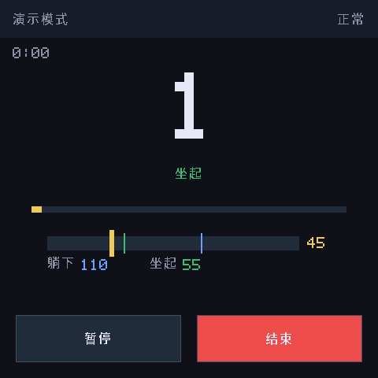
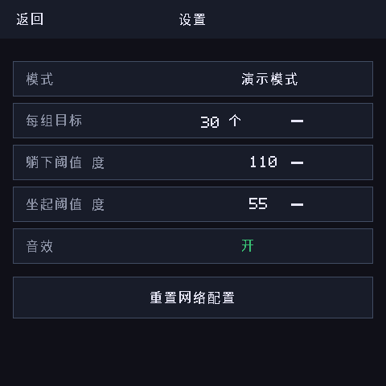

# fit-coach · 姿态健身教练

一个跑在 **ESP-Mosaico**（ESP32-S31 + 480×480 触摸屏 + 摄像头模块）上的
**仰卧起坐自动计数器**：把设备往地上一支，它就能看着你训练、帮你数个数、
播报节奏、记录历史——不需要穿戴任何设备，也不需要一直开着电脑。

| 主页 | 训练页 |
| --- | --- |
|  |  |

| 结果页 | 设置 / 历史 |
| --- | --- |
|  |  |

> 上图全部来自本仓库自带的模拟器真实渲染帧（`tools/fit_coach/check_flow.py` 自动截图）。

---

## 它是怎么工作的？

整个系统只有两件事：**「看出你躺下还是坐起」** 和 **「数准次数」**。

```
你做仰卧起坐
   │
   ▼
[摄像头模块] 拍下视频帧 ──► 压成 JPEG（ESP32-S31 硬件编码）
   │
   ▼ WiFi
[姿态识别] 算出 肩-髋-膝 三点夹角          ← 识别在哪跑？三种模式任选：
   │                                        ① 服务器模式：你家电脑/NAS/云主机
   ▼                                        ② 云端AI模式：直连视觉大模型 API
[设备端计数内核]                             ③ 演示模式：不需要任何识别
   角度 > 110° = 躺平
   角度 < 55°  = 坐起
   躺平 → 坐起 = 完成一次 ✔（迟滞状态机，绝不重复计数）
   │
   ▼
[屏幕/音效/历史] 大数字计数、角度仪表、躺/起状态、达标提示音、每日记录
```

**为什么识别不在设备上跑？** 我们实测过：ESP32 级芯片上目前唯一可用的姿态模型
（YOLO11n-Pose）单帧要 **7 秒以上**，而一个仰卧起坐只要 2~4 秒——根本跟不上。
所以设备专心做好「拍、传、数、显示、发声」，识别交给算力充足的地方。

**为什么计数在设备上跑？** 云端网络再慢也不影响数对个数：每一帧带着采集时间戳
送到计数内核，云端只是「事后判读」，断网重连计数不丢。

### 三种模式（设置页一键切换）

| 模式 | 需要什么 | 适合场景 |
| --- | --- | --- |
| **服务器**（默认推荐） | 一台跑 Python 的机器（旧电脑、NAS、云主机都行） | 家里训练，零按次费用，画质识别最准 |
| **云端AI** | 一个 OpenAI 兼容视觉模型 API（如 GLM-4V、qwen-vl） | 不想开服务器；4 帧拼一批调用，省钱 |
| **演示** | 什么都不要 | 先看效果、验收界面、给朋友秀 |

## 功能一览

- 📷 摄像头模块（SC101IOT / OV3640 均支持）自动发现，训练时才上电，省电
- 🔢 迟滞状态机计数（躺平 >110° / 坐起 <55°，阈值在设置页可调）
- 📊 训练页实时显示：超大计数、躺/起状态、角度仪表（带阈值刻度）、目标进度条、时长
- 🔊 每完成一次"哔"一声，达标奏琶音（RTTTL 合成音，无音频素材）
- 📅 历史记录（NVS 掉电保存，按日归档）
- 📶 首次配网页面：手机连设备热点，填 WiFi + 服务器地址即可，全程无需代码
- 🛡 断网提示、服务器失联横幅、计数保留恢复续计
- 🧪 计数内核 24 项单元测试 + 模拟器回放校验（页面流转/计数/像素断言）

## 快速开始

### 1. 准备环境

- **设备**：ESP-Mosaico 主机 + 摄像头扩展模块（插 LEFT 槽）
- **固件环境**：ESP-Mosaico 工作区（含 `submodule/esp-mosaico-bsp`、
  `submodule/esp-mosaico-utils`、`submodule/raylib-lite-engine`），
  ESP-IDF 固定提交 `7b9cc1ac79f865983f59bb8ff3ff43eb74ff1dbe`，target `esp32s31`。
  把本仓库放进工作区的 `projects/` 目录（即 `projects/fit_coach/`）。

> ⚠️ `main/idf_component.yml` 里的 `espressif/esp-gsp` 使用本地 override
> （`../../../weiqi-solution/dev/esp-gsp`，工作区机器上的 1.5.1 源码副本，
> 组件 CDN 已 403）。如果你的机器没有这份副本：clone esp-gsp 到任意位置，
> 把 override_path 改成你的路径即可。

### 2. 构建固件

```powershell
powershell -ExecutionPolicy Bypass -File build_fc.ps1
```

产物：`build/fit_coach.bin`（约 1.9MB）。

### 3. 起识别服务器（服务器模式）

```bash
cd server
pip install -r requirements.txt        # mediapipe==0.9.1.0（必须锁这个版本）
uvicorn pose_server:app --host 0.0.0.0 --port 8000
```

没有摄像头也不装 mediapipe 想先联调？`FC_MOCK=1` 启动即可（角度按正弦模拟）。
部署到宝塔/NAS/云主机见 [server/README.md](server/README.md)。

### 4. 刷机 + 配网 + 开练

```sh
# 在 ESP-Mosaico 工作区根目录（设备操作只走 mosaico.py）
python mosaico.py iris system-update --project projects/fit_coach
```

1. 设备首次启动会开热点 **fitcoach-XXXX**；
2. 手机连接后访问 `http://192.168.4.1`，填 WiFi 密码 + 服务器地址
   （如 `http://192.168.1.10:8000`），保存后设备自动重启联网；
3. 点 **开始训练**，把设备支在能拍到你全身侧面的位置，开练！

### 模拟器（不碰硬件先看效果）

在工作区根目录：

```sh
python mosaico.py game sim --project projects/fit_coach --headless --frames 90
# 或完整页面流校验 + 自动截图（本 README 配图就是这么来的）
cd projects/fit_coach && python tools/fit_coach/check_flow.py
```

## 目录结构

```
fit_coach/
├── main/                    # 固件（raylib-lite 路线）
│   ├── fc_count.c/h         #   计数内核（纯 C11，设备/宿主共用）
│   ├── fc_provider_http.c   #   服务器模式：POST JPEG → 回传角度
│   ├── fc_provider_vlm.c    #   云端AI模式：4 帧组批直连视觉模型
│   ├── fc_camera.c/h        #   摄像头取帧 + 硬件 JPEG 编码
│   ├── fc_net.c/h           #   SoftAP 配网门户 + STA + SNTP 对时
│   ├── fc_runtime.c/h       #   装配循环：按需启停摄像头/热切换模式
│   ├── game.c/h             #   五页 UI 状态机 + 触摸路由
│   └── gk_cjk_font.c        #   中文点阵字模渲染（含整数倍放大）
├── server/                  # MediaPipe 服务器（FastAPI + mock 模式）
├── tests/                   # 计数内核宿主单元测试（24 项）
├── tools/fit_coach/         # 字模生成 + 模拟器回放校验脚本
├── build_fc.ps1             # 构建入口
└── game.sim.json            # 模拟器源文件清单
```

## 常见问题

**计数不准 / 重复计数？**
角度阈值是按标准侧拍视角设置的；换拍摄角度或体型差异大时，进设置页微调
「躺下阈值 / 坐起阈值」，两个阈值之间的区间就是防抖缓冲带。

**画面里识别不到人？**
保证侧向拍摄、全身入镜、光线充足；训练页右上角显示「无信号」说明服务器
没回数据（检查服务器是否在跑、地址是否填对），「请入镜」说明识别到画面
里没有人。

**SC101IOT 模块图像异常？**
上游 esp_cam_sensor 2.6.0 与 BSP 的 SC101IOT PCLK 时序补丁暂不兼容
（构建时有警告但不影响编译）；遇到花屏/偏色优先换 OV3640 模块验证。

**没有服务器也不想开电脑？**
用「云端AI」模式（填一个 OpenAI 兼容视觉端点）或「演示」模式。

## 测试与验证

| 层级 | 内容 | 结果 |
| --- | --- | --- |
| 单元测试 | `tests/test_fc_count.c`：阈值边界/迟滞/抖动/漏帧/标签去抖/会话重置 | 24/24 通过 |
| 服务器端到端 | 真 MediaPipe：无人帧/真人帧/坏帧/时间戳回显 + 30 帧压测 | 10/10，p95=121ms |
| 全链路闭环 | 90 秒 300 帧（设备同款 300ms 节流）→ HTTP → **真实设备计数内核** | 计数正确 |
| 模拟器 | 页面流转/演示计数/像素断言（`check_flow.py`） | 全部通过 |
| 固件 | `fit_coach.bin` 1.87MB 构建通过（ESP-IDF 7b9cc1a） | ✅ |

联调脚本：`tools/fit_coach/test_server_e2e.py`（服务器端到端）、
`tools/fit_coach/test_closed_loop.py`（含真实计数内核的闭环）。
真机测试步骤见 **[docs/DEVICE-TEST.md](docs/DEVICE-TEST.md)**。

## 许可

[Apache-2.0](LICENSE)。其中 `main/cJSON.c|h`（MIT）、`main/rtttl_player.c|h`（MIT）、
字模生成管线与 `gk_cjk_font` 源自 ESP-Mosaico 工作区参考工程，文件头保留原始版权声明。

## 致谢

- 姿态识别算法思路源自经典的 Python + MediaPipe 仰卧起坐计数方案
  （肩 11 - 髋 23 - 膝 25 三点夹角 + 阈值状态机），本项目将其完整移植为
  设备端纯 C 内核与服务器端 FastAPI 服务。
- [MediaPipe](https://developers.google.com/mediapipe)（Apache-2.0）、
  [cJSON](https://github.com/DaveGamble/cJSON)（MIT）、
  [FastAPI](https://fastapi.tiangolo.com/)（MIT）。
